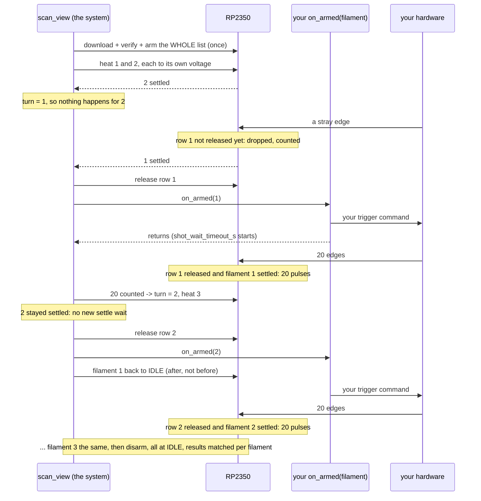

# scan_view: design (to be confirmed before it is built)

`scan_view` fires a list of filaments **in the list's order**. While one
filament fires, the next ones are already heating, so there is as little
waiting as possible. Every filament ends at IDLE.

## How it works, at a glance

`ct.scan_view([1, 2, 3], active_mv={1: 7600, 2: 7700, 3: 7650}, idle_ma=1100,
num_pulses=20, settle_ms=1000, trigger="ext", on_armed=send_trigger)`

**Timeline** (filament 2 settles before 1, then waits its turn):

```mermaid
gantt
    title scan_view([1, 2, 3]) -- fired strictly in list order
    dateFormat x
    axisFormat %S.%L s
    section filament 1
    heat to its mV          : 0, 1000
    settle (held 1 s)       : 1000, 2000
    20 pulses (your edges)  : crit, 2000, 2600
    back to IDLE            : done, 2600, 4200
    section filament 2
    heat to its mV          : 300, 1100
    settle (held 1 s)       : 1100, 2100
    settled, waits its turn : active, 2100, 2700
    20 pulses (your edges)  : crit, 2700, 3300
    back to IDLE            : done, 3300, 4200
    section filament 3
    heat to its mV          : 1300, 2300
    settle (held 1 s)       : 2300, 3300
    settled, waits its turn : active, 3300, 3400
    20 pulses (your edges)  : crit, 3400, 4000
    back to IDLE            : done, 4000, 4200
```



**Who tells whom** (the system calls your `on_armed`; your hardware sends the edges):



Step by step:

1. **Once, before anything heats:** the whole list is downloaded as ONE
   schedule (one row per filament) and verified. The STM32 is armed to
   measure every pulse, and the controllers are armed.
2. **Heating ahead:** each filament is raised to its own `active_mv` early
   enough to be settled when its turn comes (`preheat_ahead="auto"`, below).
   Several filaments are usually heating or settled at the same time.
3. **The turn moves in list order only.** Filament 1's turn comes first. As
   soon as filament 1 is settled:
   - the system **releases row 1** in the firmware;
   - the system **calls your `on_armed(1)`**;
   - your function sends the edges.
4. **Filament 1's pulses are counted.** The turn moves to 2.
   - Filament 2 settled earlier and stayed settled, so **it is not made to
     wait settle_ms again**.
   - Row 2 is released and `on_armed(2)` is called at once, about 0.1 s after
     filament 1's last pulse (host side, to be measured).
   - Only then is filament 1 dropped to IDLE.
5. ...and so on, to the end. Then: disarm, every filament at IDLE, the
   results read and matched to each filament.

**Several filaments settled at once does not mix them up.** Whether filament
2 settles before 1 does not matter:
- the system calls `on_armed` only for the filament whose turn it is;
- the firmware fires an edge only on the released row, and only while THAT
  row's filament is settled.

An edge that arrives while filament 1 is not yet settled is dropped. It never
fires filament 2.

## on_armed: the system calls YOUR function

```python
def send_trigger(filament):      # the system calls this: "filament is settled, its row
    angle_trigger.fire()         # is released -- fire it now". Your trigger command goes here.
```

- **Called once per filament, in list order, with the filament number.** The
  next call comes only after the previous filament is finished or skipped.
- **It is called when ALL of these hold:**
  - it is this filament's turn, and the previous one is finished or skipped;
  - this filament is settled: within ±150 mV, held `settle_ms`, a fresh read;
  - its row is released, and the firmware acknowledged it;
  - no dangerous fault is active;
  - HV is on.
- **Send this filament's `num_pulses` edges, then return.**
  `shot_wait_timeout_s` starts when it returns.
- It runs in its own thread. Faults are still watched while it runs.
- Edges sent too early, or too many, are dropped by the firmware and counted.
  They never fire another filament.
- Inside it, read-only `ct` calls are fine. Calls that change state are
  refused while `scan_view` runs.

## The firmware change this needs (RP2350; you flash it, test board first)

- **Per-row release and skip.** The host releases row i right before
  `on_armed`. An edge fires a pulse only if:
  1. its row is released, **and**
  2. that row's filament is settled at that instant.

  Any other edge is dropped and counted, with the reason (not released / not
  settled). The host can skip a row, or the rest of a row's pulses.
- **The trigger watchdog (`trigger_timeout_ms`) only runs while a row is
  released.** Waiting for the next filament to heat is then not a fault.
- **New fields in the SHV status:** current row, released row, dropped edges by
  reason, skipped rows.
- Both firing paths get these changes: PIO precision mode and bit-bang mode.

## Faults

| class | what happens | cases |
|---|---|---|
| **dangerous: stop now** | disarm, every hot filament to IDLE, nothing more heated, the reason reported | SHV fault; MOS stuck on after a pulse (165, `hv_stuck_on`); HV guard tripped (STM32 or backend); vacuum over its limit; HV switched off; a controller lost longer than `link_lost_timeout_s`; a HOT filament unreachable (its channel dark / board lost); host and firmware disagree on the row; the script gone (callback failed) or Ctrl-C; `on_armed` still running after `on_armed_timeout_s`; `on_armed` takes the wrong number of arguments |
| **data lost: record it, go on** | the filament is skipped, or fires only part of its pulses; the result says what and why | not settled in time; capped; open filament; `on_armed` raised; edges missing (`shot_wait_timeout_s`); edges dropped (early / extra / not settled); first-pulse 595=0 or MOS not on (`on_mismatch`); STM32 missed or saturated pulses; record buffers overflowed; a short link hiccup |
| **to decide** | | a filament's output in over-current / short (`cc_mode 3`): skip it, or stop? |

## Timeouts

| | waits for | timed by | value | when it runs out |
|---|---|---|---|---|
| T1 | download, verify, arm, STM32 arm | host, per request | request timeouts, retried 10 s across a bridge reconnect | nothing started, nothing touched |
| T2 | a filament reaching its voltage | host, from its raise | `heat_timeout_s` | skipped (data lost) |
| T3 | holding it | RP2350 | `settle_ms` (restarts if it drops out) | part of T2 |
| T4 | your `on_armed` returning | host | `on_armed_timeout_s` (default `shot_wait_timeout_s`) | stop |
| T5 | its `num_pulses` edges, after `on_armed` returns | host | `shot_wait_timeout_s` | the rest of its pulses skipped (data lost) |
| T6 | the next edge within one filament | RP2350, only while its row is released | `trigger_timeout_ms` | the rest of its pulses skipped (data lost) |
| T7 | the whole schedule | RP2350 | `total_ms`; `None` = computed from the list | firmware stops (dangerous backstop) |
| T8 | a pre-heated filament's timed VOLTAGE | backend | its predicted wait + `heat_timeout_s` + margin, renewed if the wait grows | the backend drops it to IDLE; it is re-heated at its turn (T2) |
| T9 | the STM32 measurement's validity | STM32 | the whole run's predicted length (now fixed at 60 s), or renewed mid-run | the rest has no current (data lost) |
| T10 | room in the pulse log / STM32 event buffer | firmware | read filament by filament during the run | data lost |
| T11 | lease / remote call kept alive | backend | renewed for the whole run | stop |
| T12 | a controller link | host | `link_lost_timeout_s` | shorter: retried, its edges may be dropped (data lost); longer: stop |
| T13 | backend safety watchdogs (ACTIVE -> SLEEP 30 s, grid opened after 10 s without an HV command) | backend | each checked so a long run does not trip them | -- |
| T14 | **any pulse at all**, from the first `on_armed`, reset by every pulse | host | `no_pulse_timeout_s` = `heat_timeout_s + settle_ms/1000 + shot_wait_timeout_s` | stop: e.g. the trigger source is dead |

## preheat_ahead="auto": each filament settled just when its turn comes

- **Its heating time** comes from its own history in `filament_perf`: raise to
  arrived, at a voltage within ±300 mV of this one, 75th percentile. Then
  `settle_ms` is added.
  - Not enough history: this run's measurements.
  - Still nothing: 3 s.
- **Time per turn** is the median, so far in this run, of release to last
  pulse.
  - Before the first one: `num_pulses × pulse_interval_ms` for `"sim"`, a
    cautious guess for `"ext"`.
- **Raise filament j at:** (predicted start of its turn) − (its heating time)
  − `preheat_margin_s`.
- **Never more hot at once than** `max_hot`, `max_hot_per_board` and
  `max_hot_per_controller`.
- **It corrects itself.** Each filament's time hot and only waiting (too
  early), and time its turn waited for it (too late), are recorded. The lead
  is adjusted from them and saved in `filament_perf` for next time.
- `preheat_ahead=N` (a number) means always N filaments ahead, with no
  prediction.

## Arguments

Same meaning as in `fire_single_pulse`, so same name:
- `active_mv`: here `{filament: mV}`, every filament its own.
- `idle_ma`, `num_pulses`, `width_us`, `pulse_interval_ms`,
  `trigger_timeout_ms`, `max_on_ms`, `total_ms`, `trigger`.
- `on_armed`: here called as `on_armed(filament)`.
- `shot_wait_timeout_s`, `heat_timeout_s`, `settle_ms`, `verify`,
  `measure`, `rate_hz`, `bg_gap_us`, `bg_window_us`.

Not here:
- `reuse`: always downloaded.
- `controller`: found from each filament.

New:

| name | meaning | default |
|---|---|---|
| `preheat_ahead` | how far ahead to heat: `"auto"` or a number of filaments | `"auto"` |
| `preheat_margin_s` | `"auto"`: start heating this much earlier still | 0.3 |
| `max_hot` | at most this many filaments hot at once, in total | 6 |
| `max_hot_per_board` | at most this many hot on one 8-way board | **to decide** |
| `max_hot_per_controller` | at most this many hot on one controller | **to decide** |
| `on_armed_timeout_s` | longest your `on_armed` may run | `shot_wait_timeout_s` |
| `no_pulse_timeout_s` | stop if no pulse at all for this long | `heat_timeout_s + settle_ms/1000 + shot_wait_timeout_s` |
| `link_lost_timeout_s` | stop if a controller is lost for this long | 5 |

## Result

- One row per filament, in list order. Each row has:
  - `filament`;
  - `fired`: how many pulses fired;
  - `skipped`, with the reason;
  - the voltage it fired at;
  - heating time, time hot and only waiting, time its turn waited for it;
  - edges dropped, by reason;
  - the 165 / HV-stuck flags;
  - per pulse: mA and mAms, matched to the firmware's pulse records by time.
- Totals:
  - `ok`;
  - `stopped`, with the reason;
  - filaments fired, skipped, partly fired;
  - edges dropped;
  - the time from each filament's last pulse to the next `on_armed`;
  - the elapsed time.

## Still to decide

1. `max_hot_per_board` and `max_hot_per_controller`, or a total current
   limit instead.
2. A filament in over-current / short: skip it, or stop the list?
3. Whether HV must be on (checked at the start, and a stop if it goes off).
4. The firmware change above.

## Tests, before it is used

Offline:
- every fault class and every timeout above;
- 2 settling before 1;
- `on_armed` hanging, raising, or taking no argument;
- extra, early and missing edges;
- the measurement matched to the right filament across skipped and partial
  rows.

Firmware, on the test board:
- an edge on a row that is not released is dropped;
- an edge on a filament that is not settled is dropped;
- the watchdog is quiet between rows.

Rig, `"sim"` first:
- the gap from one filament to the next is measured;
- then `"ext"`.
