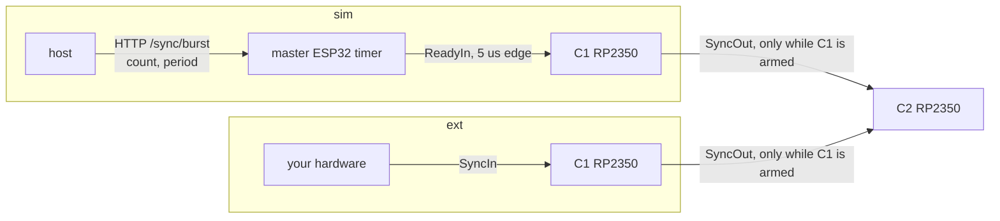

# scan_view — parameters and timing: design

**Status: proposal, nothing built.** Section 11 lists what must be decided
before any code changes.

## 1. What this document designs

`scan_view` fires a list of filaments, strictly in list order. Each filament
gets `num_pulses` HV pulses while it is HOT. The next filaments are already
heating while one fires, and every filament ends at IDLE.

Today it has 13 timing-related parameters, several with overlapping jobs, and
`heat_timeout_s` means something other than intended. This design fixes three
things:

1. **The parameter set.** Which parameters exist, what each one means, and who
   enforces it (host, backend, RP2350, ESP32).
2. **How every parameter is used in each trigger mode**: `sim` (the library
   makes the edges) and `ext` (your hardware makes them).
3. **What happens in time.** The workflow step by step, and for every failure,
   which mechanism catches it and when.

It is the same machinery for `fire_single_pulse` (one filament). Section 10
covers the names they share.

## 2. The call

Every argument is written with its name: the function takes no positional
arguments, so a call without names is a TypeError. The trigger mode is ONE
argument, `trigger=`, whose value is `ct.Sim(...)` or `ct.Ext(...)`. What
only one mode uses lives inside it, so the other mode cannot be given it, and
"both" cannot even be written.

```python
# trigger = sim: the library makes the edges
r = ct.scan_view(
    filaments=[0, 1, 95],                    # fired in this order
    active_mv={0: 7000, 1: 7050, 95: 6950},  # each filament's heating voltage
    idle_ma=1200,                            # back to this after its pulses
    settle_ms=1000,                          # HOT = this long after the FIRST arrival
    heat_timeout_s=10,                       # longest one filament may stay heated
    num_pulses=20,                           # pulses per filament
    width_us=12000,                          # HV pulse width
    trigger=ct.Sim(
        pulse_interval_ms=26,                # the train's edge spacing
        trigger_timeout_ms=None,             # gap limit; None = 2 x 26 + 100 = 152
        on_armed=None,                       # optional: called before each train
    ),
    measure=ct.Measure(                      # or measure=None: no measurement
        rate_hz=1_000_000,
        bg_gap_us=100.0,
        bg_window_us=50.0,
    ),
    preheat_ahead="auto",                    # rarely changed from here on
    preheat_margin_s=0.3,
    max_hot=6,
    max_voltage_drop_mv=500,
    link_lost_timeout_s=5.0,
    verify=True,
)

# trigger = ext: your hardware makes the edges
r = ct.scan_view(
    filaments=[0, 1, 95],
    active_mv={0: 7000, 1: 7050, 95: 6950},
    idle_ma=1200,
    settle_ms=1000,
    heat_timeout_s=10,
    num_pulses=20,
    width_us=12000,
    trigger=ct.Ext(
        on_armed=on_armed,                   # required: start your edges in it
        trigger_timeout_ms=60,               # required: gap limit for YOUR spacing
    ),
    measure=ct.Measure(rate_hz=1_000_000, bg_gap_us=100.0, bg_window_us=50.0),
    preheat_ahead="auto",
    preheat_margin_s=0.3,
    max_hot=6,
    max_voltage_drop_mv=500,
    link_lost_timeout_s=5.0,
    verify=True,
)
```

`ct.Sim`, `ct.Ext` and `ct.Measure` take named arguments only and return a
plain dict; `ct.Sim` / `ct.Ext` put the mode in it (`{"mode": "sim", ...}`).
A misspelt name fails at once, and the dict passes through the remote proxy
unchanged (`on_armed` inside it is still called back). A hand-written dict is
checked the same way: a missing or unknown `mode`, or an unknown key, is
refused.

## 3. Who does what

| part | job in a run |
|---|---|
| **host** (`scan_view`, runs inside the backend) | the order; raises filaments, waits for HOT, releases rows, calls `on_armed`, starts sim trains, decides skip/stop, reads measurements |
| **backend timers** | each filament's heating window (`heat_timeout_s`): drops it to IDLE at the end even if the host has died |
| **master ESP32** (sim only) | its hardware timer sends the sim edges |
| **RP2350, each controller** | regulates the heating; reports arrival and HOT (`settle_ms`); fires one `width_us` pulse per edge for the RELEASED row only; times edge gaps (`trigger_timeout_ms`) |
| **STM32** (master) | measures each pulse inside the master's envelope |
| **your code** | `on_armed(f)`; with `ext`, the hardware that makes the edges |

## 4. Every parameter: what it does in `sim` and in `ext`

### Heating — the same in both modes

| parameter | meaning | enforced by | default / range |
|---|---|---|---|
| `filaments` | the filaments, fired strictly in this order | host | required; no repeats, none dead |
| `active_mv` | each filament's heating voltage (VOLTAGE mode) | RP2350 voltage loop | required, one per filament |
| `idle_ma` | the IDLE current each filament returns to | RP2350 current loop | required |
| `settle_ms` | after the FIRST arrival (load V within ±150 mV), wait this long; then it is HOT. A wobble does not restart it; a drop of more than `max_voltage_drop_mv` (3 reads) or an output fault "interrupts" it | RP2350 (CH_ARRIVAL_SETTLE, CH_GET_HOT) | required, 0..60 000 ms |
| `heat_timeout_s` | **the longest one filament may stay heated in one go**: from its VOLTAGE command until it is back at IDLE. A hard limit, never renewed | backend timer | Q3 (10 s proposed) |
| `preheat_ahead`, `preheat_margin_s`, `max_hot` | when to raise each filament so it is HOT about when its turn comes; at most `max_hot` heating at once | host | `"auto"`, 0.3 s, 6 |
| `max_voltage_drop_mv` | a drop larger than this below `active_mv` (3 reads) = heating interrupted | RP2350 | 500 mV |

### Firing — both modes

| parameter | meaning | enforced by | default / range |
|---|---|---|---|
| `num_pulses` | pulses per filament = edges per filament | RP2350 (row length) | 1..255 |
| `width_us` | the HV pulse width. The edge that triggers it does not set it: a sim edge is a fixed 5 µs ESP32 pulse, and an ext edge may be any width | RP2350 PIO | 1..65 535 µs (firmware u16) |

### `trigger=ct.Sim(...)` — the library makes the edges

| parameter | meaning | enforced by | default / range |
|---|---|---|---|
| `pulse_interval_ms` | the spacing of the train: the master ESP32's timer period is `pulse_interval_ms` × 1000 µs, hardware-timed | master ESP32 | 500; must be > `width_us`; ≥ 0.5 with `measure` |
| `trigger_timeout_ms` | the longest gap between two consecutive edges of the same filament, from its first edge. With a hardware-timed train it only catches a lost edge or a dead train | RP2350 | 2 × `pulse_interval_ms` + 100; must be > `pulse_interval_ms` |
| `on_armed` | optional `on_armed(f)`, called at f's turn; the train starts after it RETURNS | host | None |

The host sends one request per filament: `num_pulses` edges,
`pulse_interval_ms` apart (§5).

### `trigger=ct.Ext(...)` — your hardware makes the edges

| parameter | meaning | enforced by | default / range |
|---|---|---|---|
| `on_armed` | `on_armed(f)`, called at f's turn: start your `num_pulses` edges here (or start what sends them) and return | host | **required** |
| `trigger_timeout_ms` | the longest gap between two consecutive edges of the same filament, from its first edge: a little over YOUR spacing | RP2350 | **required** (only you know your spacing; Q6) |

Your edges go into the master's SyncIn (§5). The host does not know their
spacing, so it cannot check it against the measurement minimum before
starting (Q12).

### `measure=ct.Measure(...)` — or `measure=None`

| parameter | meaning | default |
|---|---|---|
| `rate_hz` | STM32 sample rate | 1 000 000 |
| `bg_gap_us`, `bg_window_us` | the background is averaged over `bg_window_us`, taken `bg_gap_us` before the pulse's rise and again after it | 100, 50 |

Pulses closer than 0.5 ms (`MIN_INTER_PULSE_US`) leave no clean background.

### Housekeeping

| parameter | meaning | default |
|---|---|---|
| `verify` | read the schedule back before arming | True |
| `link_lost_timeout_s` | a command link (L2/L3, §9) down this long → the run stops. Leave it at 5 s | 5.0 |

## 5. The two trigger paths



The rules that hold for both paths:
- C1 is the master: the head of the chain. Every edge reaches C1 first, and C1
  forwards it to C2 only while its own schedule is armed.
- Both RP2350s walk the same table. On each edge, the board whose filament's
  row is released fires a `width_us` pulse; the other board only counts it.
- An edge with no released row fires nothing on either board: it is dropped
  and counted (`dropped_edges`).

Specific to `sim`:
- Only the master ESP32 can make a train. If the master's link is down,
  nothing can fire, on either controller.
- There is one HTTP request per filament, after `on_armed` returns. It is
  served by the ESP32's single-threaded web server: about 65 ms when idle,
  200–300 ms under load.
- Only one train can run at a time. The backend learns a train has ended
  only on its next ESP32 poll, every 300 ms. Right after a filament it still
  says "already running", and today the host retries for up to 2 s (Q9).
- **A train runs on its own once started.** If a filament ends before its
  train does, the rest of the train fires the NEXT filament unless the train
  is stopped and confirmed stopped before the next row is released (Q8).
  Today scan_view never stops a train.


## 6. The workflow

**Checks.** Nothing is touched; on failure the call is refused with a reason.

1. Every filament has its own `active_mv`, and none is dead.
2. HV (emission and focus) is on, the HV guard is not tripped, and the vacuum
   is within its limit.
3. `trigger` is a `ct.Sim` or `ct.Ext`, every key known. `width_us` is 1..65 535.
   sim: `pulse_interval_ms` × 1000 > `width_us`, `trigger_timeout_ms` >
   `pulse_interval_ms`, and with `measure` the spacing is ≥ 0.5 ms. ext:
   `on_armed` and `trigger_timeout_ms` given.
4. The window holds one filament's work (§7). If not: Q4.

**Setup.** All filaments are at IDLE.

5. Download ONE gated schedule (all filaments, in order) to every controller
   that fires or frames a pulse, and read it back.
6. Write `settle_ms` and `max_voltage_drop_mv` to the RP2350s, arm the STM32
   measurement, then ARM.

**Per filament f, in list order:**

7. **Raise** f to VOLTAGE `active_mv[f]`, early enough to be HOT by its turn.
   f's window opens, and the backend timer is set to `heat_timeout_s`.
8. **HOT**: the RP2350 reports first arrival + `settle_ms`, not interrupted.
9. **Its turn**: the previous filament's pulses are all counted. Release f's
   row on every armed controller.
10. **`on_armed(f)`** is called.
11. **Edges.**
    - sim: one request starts a train of `num_pulses` edges,
      `pulse_interval_ms` apart.
    - ext: your hardware sends `num_pulses` edges.
12. **Pulses**: one `width_us` pulse per edge. From the first edge, every gap
    must be shorter than `trigger_timeout_ms`.
13. **Measurement**: the host reads the STM32 events while they arrive (the
    ESP32 keeps only the last 128).
14. **Done**: all `num_pulses` are counted. f goes back to IDLE as soon as the
    next filament is released, and its window closes.

**End.** This runs whatever ended the run.

15. Stop any sim train and disarm. Every filament goes to IDLE (a faulted one
    to SLEEP). Set `settle_ms` back to 0, read the pulse logs, and match the
    measurements to filaments.


## 7. The heating window: what has to fit in it

From the raise, one filament's work takes:

```
heat-up (raise -> first arrival)        from its history (filament_perf), ~2-3 s at 4-7 V
+ settle_ms / 1000
+ wait for its turn                     ~0 when preheat_ahead="auto" works
+ on_armed                              your code
+ sim only: start request               0.07-0.3 s
+ (num_pulses - 1) x spacing            sim: pulse_interval_ms; ext: your source
```

Worked example, sim, using the numbers in section 2:
- heat-up 2.5 s + settle 1.0 s + request 0.3 s + 19 × 26 ms (0.49 s) ≈ 4.3 s;
- with `heat_timeout_s` = 10 s, that leaves about 5.7 s of margin;
- `trigger_timeout_ms` defaults to 2 × 26 + 100 = 152 ms.

## 8. When something goes wrong

Each filament has one limit, its window. Anything that has not happened by
the end of the window is caught there. `trigger_timeout_ms` catches a gap
between edges. `total_ms` (computed: filaments × `heat_timeout_s` + 30 s) is
the firmware's last backstop.


| failure | caught by | result | old parameter it replaces |
|---|---|---|---|
| never gets HOT | window end | IDLE, skipped, the run goes on | `heat_timeout_s` (wait for arrival) |
| HOT, but its turn comes late | window end | IDLE, re-heated at its turn (Q1) | backend renewed the heating, no limit |
| `on_armed` hangs | window end, `on_armed` still running | STOP | `on_armed_timeout_s` |
| no edge ever comes | window end | IDLE, skipped; 2 filaments in a row: STOP | `shot_wait_timeout_s`, `no_pulse_timeout_s` |
| edges stop half way | `trigger_timeout_ms` | STOP (firmware) — or skip the rest (Q2) | (kept) |
| pulses outlast the window | window end | sim: stop the train and confirm; IDLE; the rest skipped | `shot_wait_timeout_s` |
| dangerous: SHV fault, MOS stuck on, HV guard, vacuum, HV off | checked every 0.5 s | STOP | (unchanged) |
| a command link down > `link_lost_timeout_s` | §9 | STOP | (unchanged) |

STOP means: stop any sim train, disarm, every filament to IDLE (a faulted one
to SLEEP), and `stopped` says why.

## 9. Links

| | link | carries | lost: consequence | watched by |
|---|---|---|---|---|
| L1 | your script ↔ backend | the `on_armed` call | the run cannot call `on_armed` (Q5) | session ping 3 s, reaper 15 s |
| L2 | backend ↔ ESP32, each controller (WiFi TCP) | release, VOLTAGE/IDLE, sim start | **no IDLE can be sent: a heated filament stays heated** | `link_lost_timeout_s` (today) |
| L3 | ESP32 ↔ RP2350, each controller (UART) | the same, one hop further | same as L2, while L2 still looks connected | RP2350 heartbeat age — **not watched today** (Q11) |
| L4 | ESP32 ↔ STM32, master (UART) | measurements | measurements lost; firing unaffected | event ids jump → that filament has no measurement |
| L5 | RP2350 ↔ boards (I²C) | heating, arrival, HOT | that filament interrupted → skipped | HOT/interrupted flags |
| L6 | SyncIn/SyncOut wires, envelope | the edges | edges missing | `trigger_timeout_ms`; envelope count |

The RP2350 has no fallback of its own. If L2 or L3 stays down, nothing drops a
heated filament: the backend's window ends, but its IDLE cannot arrive (Q7).

## 10. Removed and renamed

| parameter | becomes | why |
|---|---|---|
| `heat_timeout_s` = "wait for first arrival" | `heat_timeout_s` = longest heating | the window covers the arrival too |
| `shot_wait_timeout_s` (and old `timeout_s`) | removed | inside the window |
| `on_armed_timeout_s` | removed | inside the window (still running at its end → STOP) |
| `no_pulse_timeout_s` | removed | every filament ends within its window; 2 in a row without an edge → STOP |
| `total_ms` | removed as a parameter; computed | firmware backstop only |
| `max_on_ms` | removed; the host writes the firmware's maxOnMs itself | the firmware check is "width above maxOnMs" — it only restated `width_us` |
| backend timed-VOLTAGE length | = `heat_timeout_s`, never renewed | one hard limit |
| positional `filaments, active_mv, idle_ma, settle_ms` | named only | a call reads the same everywhere; no positional arguments at all |
| `trigger="sim"/"ext"`, `on_armed=`, `pulse_interval_ms=`, `trigger_timeout_ms=` | `trigger=ct.Sim(...)` or `trigger=ct.Ext(...)` | one argument picks the mode, and what that mode uses is inside it; the other mode cannot be given it by mistake |
| `measure=`, `rate_hz=`, `bg_gap_us=`, `bg_window_us=` | `measure=ct.Measure(...)` or `None` | the sampling settings exist only when measuring |

`fire_single_pulse` takes the same names with the same meanings:
`heat_timeout_s`, `settle_ms`, `trigger_timeout_ms`, `pulse_interval_ms`,
`width_us`. Its `shot_wait_timeout_s`, `max_on_ms` and `total_ms` go too.

The low-level `voltage_one` / `active_one` keep `active_s` (heat this long,
then the backend returns it to IDLE). It is the same idea one level down.

What combined_backend passes today will break:
- to `fire_single_pulse`: `max_on_ms`, `total_ms`, `shot_wait_timeout_s`;
- to `scan_view`: `max_on_ms`, `total_ms`, `shot_wait_timeout_s`.

It changes in the same step. It also sets the backend dead-man to
`active_timeout_s=4.0`, which must stay longer than the gap between commands
during a window.

## 11. To decide

| | question | proposal |
|---|---|---|
| Q1 | a filament HOT but still waiting when its window ends | back to IDLE, re-heated at its turn (no data lost) |
| Q2 | `trigger_timeout_ms` runs out | today: the firmware stops the whole run. Alternative: skip the rest of that filament (firmware change) |
| Q3 | `heat_timeout_s` default | 10 s |
| Q4 | the window cannot hold one filament's work (§7) | refuse before starting |
| Q5 | ext, your script disconnects mid-run | STOP |
| Q6 | ext `trigger_timeout_ms` | required in `ct.Ext` (only you know your spacing) |
| Q7 | RP2350 drops a heated filament by itself after `heat_timeout_s` if no IDLE comes | yes; firmware change, test board first |
| Q8 | sim: stop and confirm the train before the next row when a filament ends early, and on every STOP | yes |
| Q9 | sim "already running" right after a filament | the backend asks the ESP32 directly; drop the host's 2 s retry |
| Q10 | `settle_ms` in fire_single_pulse is "held continuously"; in scan_view "from the first arrival" | one rule for both: from the first arrival |
| Q11 | `link_lost_timeout_s` watches L2 only | watch L2 and L3 |
| Q12 | ext: the measurement spacing check (≥ 0.5 ms) needs the edge spacing, which only you know | give `ct.Ext` an optional `expected_interval_ms` used ONLY for that check — or drop the check for ext and flag a pulse whose background was not clean |
| Q13 | same call shape for `fire_single_pulse` (`filament=`, `trigger=ct.Sim/ct.Ext`, `measure=`) | yes |
