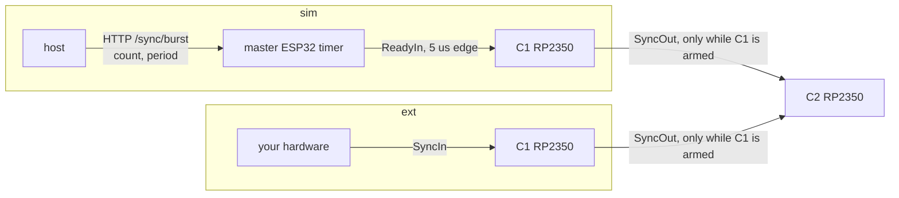

# Firing filaments: fire_single_pulse and scan_view — design

**Status: proposal, nothing built.** The last section lists what must be
decided before code changes. The next step after this design is running
`scan_view` at scale. Today it is a concept that has only run in tests.

## 1. How it is used today (from the logs)

Source: the ct_gui client logs on the rig PC (2026-09-24 .. 10-28, about 380 MB)
and on control2, plus combined_backend's code.

`fire_single_pulse` is the tool that runs every day; `scan_view` has only run
in tests. Two programs call it:

| | **"auto test"** (client `ct_simple_control`) | **combined page** (client `combined_backend`) |
|---|---|---|
| shots | 12 013 | 4 537 |
| sequence per filament | `idle_one(1200)` → `fire_single_pulse(...)` → `idle_one(1200)` | `fire_single_pulse(...)` → `idle_one(1200)`, then the detector and gantry, about 4–5 s |
| heating | ACTIVE at a **per-filament calibrated current**, e.g. 2379, 2435, 2389 mA (`active_ma`) | ACTIVE at 2600 mA (also 2700, 2680) |
| `heat_timeout_s` / `idle_ma` | 6 s / 1200 mA | 6 s / 1200 mA |
| trigger | sim (11 992 of 12 013) | **ext** (3 758 of 4 537): the page's `on_armed` tells the page to start the detector, whose hardware sends the edge |
| pulses | 1 (8 340), 10 (1 566), 20 (1 359) | 1 (2 530), 20 (1 056), 10 (887) |
| width | 7 ms mostly; also 22, 6, 2, 12, 40 ms | 22, 30, 12, 5, 9 ms |
| spacing / gap limit | `inter_pulse_ms=100` (sim spacing) | `inter_pulse_ms=3000` (ext: the wait for the edge) |
| **trigger delay** | `set_trigger_delay(3000)` before every run: each pulse fires **3 ms after its edge** | 3000 µs set from the page's box (30 times); the box is now 0 |
| measurement | always (`measure=True`, 1 MSPS, bg 100/50 µs) | always |
| one shot takes | 8–14 s (once 37 s): heating + 10 pulses | 3.2–4.1 s: heating + 1 pulse |

The "auto test" set-up before its filaments:
1. `safety_config(active_timeout_s=6)`, `set_dead`, `set_filament_order`, the
   lease;
2. STOP → SLEEP → STANDBY → IDLE 1200 mA;
3. emission 200 V / 45 mA, focus 210 V, emission on;
4. `set_trigger_delay(3000)`.

What goes wrong, most frequent first. Each needs a defined outcome:

| failure | count | what it is |
|---|---|---|
| filament in the dead mask | ~250 | refused before anything is touched (correct) |
| HV did not turn on (ON read-back ≠ commanded) | ~200 | the grid switch read-back after the pulse |
| ext: no edge in time ("timed out after 6.0 s", "shot_wait timed out 9 s") | 133 | the detector never sent its edge |
| arm rejected, NotReady | 73 | a channel/expander unreadable |
| download failed | 44 | link |
| measurement incomplete (0 of 1) | 13 | the STM32 sent no event for the pulse |
| spacing shorter than width | 12 | refused before anything is touched (correct) |

## 2. Design rules

1. **Every argument is named.** No positional arguments.
2. **One choice = one argument whose value says which.** For example,
   `trigger=ct.Sim(...)` or `ct.Ext(...)`, and `heating=ct.Current(...)` or
   `ct.Voltage(...)`. "Both" cannot be written.
3. **What only one choice uses lives inside it.** For example, the sim spacing
   lives in `ct.Sim`, the IDLE current and the window live in the heating, and
   the sampling lives in `ct.Measure`.
4. **One name, one meaning**, in both functions.
5. **Nothing hidden.** Everything that changes how a shot fires is an argument
   of that shot. The trigger delay is set today by a separate call, kept by
   the board, and lost when a board restarts; it becomes an argument (§3).
6. **Every shot is measured.**

`ct.Sim`, `ct.Ext`, `ct.Current`, `ct.Voltage` and `ct.Measure` take named
arguments only and return a plain dict that carries its kind. A misspelt name
fails at once. The dict passes the remote proxy unchanged, and `on_armed`
inside it is still called back.

## 3. The two calls

### 3.1 fire_single_pulse: one filament

```python
r = ct.fire_single_pulse(
    filament=16,
    heating=ct.Current(
        active_ma=2600,                # ACTIVE at this current for the shot
        idle_ma=1200,                  # back to this right after
        settle_ms=0,                   # HOT = this long after the FIRST arrival
        heat_timeout_s=10,             # longest it may stay heated, raise -> back at IDLE
    ),
    num_pulses=1,
    width_us=30000,
    trigger_delay_us=3000,             # each pulse fires this long after its edge
    trigger=ct.Ext(
        on_armed=on_armed,             # on_armed(f): start the detector; it sends the edge
        trigger_timeout_ms=None,       # gap between edges; not used with num_pulses=1
    ),
    measure=ct.Measure(rate_hz=1_000_000, bg_gap_us=100.0, bg_window_us=50.0),
    controller=None,                   # None = the filament's own board
    reuse=True,                        # skip the download when unchanged
    link_lost_timeout_s=5.0,
    verify=True,
)
```

### 3.2 scan_view: a list of filaments, in order

The same arguments, for a list. The heating takes one value per filament.

```python
r = ct.scan_view(
    filaments=[0, 1, 2],
    heating=ct.Current(
        active_ma={0: 2379, 1: 2435, 2: 2389},   # exactly one per listed filament
        idle_ma=1200,
        settle_ms=0,
        heat_timeout_s=10,
    ),
    num_pulses=10,
    width_us=7000,
    trigger_delay_us=3000,
    trigger=ct.Sim(
        pulse_interval_ms=100,         # the train's edge spacing
        trigger_timeout_ms=None,       # None = 2 x 100 + 100 = 300
        on_armed=None,
    ),
    measure=ct.Measure(rate_hz=1_000_000, bg_gap_us=100.0, bg_window_us=50.0),
    preheat_ahead="auto",              # raise the next ones early enough to be HOT
    preheat_margin_s=0.3,
    max_hot=6,
    link_lost_timeout_s=5.0,
    verify=True,
)
```

`fire_single_pulse` with a heating IS `scan_view` with one filament: the same
steps, gating, window and failures (§5–§7). Its own arguments are `filament`
(singular), `controller`, `reuse`, and `heating=None` (§4.2).

### 3.3 Today's calls, rewritten

| today | becomes |
|---|---|
| "auto test": `set_trigger_delay(3000)` once; per filament `idle_one(f, 1200)`, `fire_single_pulse(filament=f, num_pulses=10, width_us=7000, inter_pulse_ms=100, max_on_ms=165, total_ms=6000, trigger="sim", timeout_s=6.0, active_ma=cal[f], idle_ma=1200, heat_timeout_s=6, measure=True, ...)`, `idle_one(f, 1200)` | one `scan_view(filaments=order, heating=ct.Current(active_ma=cal, idle_ma=1200, settle_ms=0, heat_timeout_s=10), num_pulses=10, width_us=7000, trigger_delay_us=3000, trigger=ct.Sim(pulse_interval_ms=100), measure=ct.Measure(...))`. The idle_one calls disappear: every filament ends at IDLE |
| combined: `fire_single_pulse(filament=f, num_pulses=1, width_us=30000, inter_pulse_ms=3000, max_on_ms=66, total_ms=12000, trigger="ext", shot_wait_timeout_s=9, active_ma=2600, idle_ma=1200, heat_timeout_s=6, measure=True, ...)`, then `idle_one` | `fire_single_pulse(filament=f, heating=ct.Current(active_ma=2600, idle_ma=1200, settle_ms=0, heat_timeout_s=10), num_pulses=1, width_us=30000, trigger_delay_us=3000, trigger=ct.Ext(on_armed=...), measure=ct.Measure(...))`. A whole view: `scan_view` with the same arguments and `active_ma={f: 2600 ...}` |

## 4. Every parameter

### 4.1 Top level

| parameter | function | meaning | default / range |
|---|---|---|---|
| `filaments` / `filament` | scan_view / fire_single_pulse | fired strictly in this order / the one filament | required; no repeats, none dead |
| `heating` | both | §4.2 | required |
| `num_pulses` | both | pulses per filament = edges per filament | 1..255 |
| `width_us` | both | the HV pulse width (RP2350 PIO). The edge does not set it | 1..65 535 µs |
| `trigger_delay_us` | both | **each pulse fires this long after its edge** (RP2350 hardware alarm; sim and ext alike; the measurement window moves with it). Written to every controller at set-up and read back; the ARM is refused if they disagree | **required**, 0..65 535 µs |
| `trigger` | both | §4.3 | required |
| `measure` | both | §4.4: every pulse is measured | required |
| `preheat_ahead`, `preheat_margin_s`, `max_hot` | scan_view | when to raise each filament so it is HOT about when its turn comes; at most `max_hot` heating at once | `"auto"`, 0.3 s, 6 |
| `controller` | fire_single_pulse | which controller fires; `None` = the filament's own board | `None` |
| `reuse` | fire_single_pulse | skip the download when unchanged since the last shot | `False` |
| `verify` | both | read the schedule back before arming | `True` |
| `link_lost_timeout_s` | both | a command link (L2/L3, §8) down this long → STOP. Leave it at 5 s | 5.0 |

### 4.2 `heating=`

| | `ct.Current(...)` — what runs every day | `ct.Voltage(...)` | `None` |
|---|---|---|---|
| for | both | both | fire_single_pulse only |
| heats with | ACTIVE at `active_ma` (current loop) | VOLTAGE mode at `active_mv` | nothing: fired in the state the caller left it in |
| `active_ma` / `active_mv` | scan_view: `{filament: value}`, exactly the listed filaments (Q12); fire_single_pulse: one number | same | — |
| "arrived" | the current loop converged at `active_ma`, not capped | load voltage within ±150 mV | — |
| `idle_ma` | back to this when the filament is done | same | — |
| `settle_ms` | after the FIRST arrival wait this long; then HOT. An output fault interrupts it | same; a drop of more than `max_voltage_drop_mv` (3 reads) also interrupts it | — |
| `max_voltage_drop_mv` | — | default 500 | — |
| `heat_timeout_s` | the longest the filament may stay heated in one go: from its heating command until it is back at IDLE. Backend-timed, never renewed | same | — (Q13) |
| schedule | gated: a pulse fires only on a released row whose filament is HOT | gated | not gated: any edge after ARM fires; the caller owns the state |

### 4.3 `trigger=`

| | `ct.Sim(...)` — the library makes the edges | `ct.Ext(...)` — your hardware makes them |
|---|---|---|
| `on_armed` | optional `on_armed(f)`, called at f's turn; the train starts after it RETURNS | **required** `on_armed(f)`: start your source (e.g. the detector) and return |
| `pulse_interval_ms` | the train's spacing: the master ESP32 timer's period, hardware-timed. Must be > (`trigger_delay_us` + `width_us`) / 1000 (§6) and ≥ 0.5 (measurement). Default 500 | — (Q11) |
| `trigger_timeout_ms` | the longest gap between two edges of the same filament, from its first edge. Default 2 × `pulse_interval_ms` + 100 | the same, a little over YOUR spacing. Required when `num_pulses` > 1; unused with 1 pulse |
| where edges enter | master ESP32 → master RP2350 (ReadyIn) | the master's SyncIn |
| the first edge | one request after `on_armed` returns (65–300 ms) | whenever your source sends it; bounded by the window (§7) |

### 4.4 `measure=ct.Measure(...)` — required

| parameter | meaning | default |
|---|---|---|
| `rate_hz` | STM32 sample rate | 1 000 000 |
| `bg_gap_us`, `bg_window_us` | background averaged over `bg_window_us`, taken `bg_gap_us` before the pulse's rise and again after it | 100, 50 |

If the measurement cannot be armed, the call is refused before anything is
heated. A pulse whose event does not come is reported as missing, never as
another pulse's.

## 5. The trigger paths and the trigger delay



- C1 (the master) is the head of the chain. It forwards each edge to C2
  at once, only while its own schedule is armed.
- **Each board applies `trigger_delay_us` itself.** On an edge it starts a
  hardware alarm; the pulse fires when the alarm runs out. Both boards must
  hold the same delay, or the master's measurement window misses the other
  board's pulse. That is why the ARM is refused when they differ.
- Both RP2350s walk the same table. The board whose filament's row is
  released fires; the other only counts the edge.
- With a gated schedule, an edge with no released row fires nothing: it is
  dropped and counted.

Specific to `sim`:
- Only the master ESP32 makes trains; one request per filament, one train at
  a time. The backend sees a train's end only on its 300 ms poll (Q8).
- **A train runs on its own once started.** If a filament ends early, the
  rest of the train would fire the next filament. The train must be stopped
  and confirmed stopped before the next row is released (Q7).


## 6. Timing of one pulse

```
edge ──(trigger_delay_us)──> pulse ON ──(width_us)──> OFF ──(gap)──> next edge
```

- **The next edge must come after the pulse is over:** spacing >
  `trigger_delay_us` + `width_us`. All edges share one alarm on the RP2350. An
  edge during the delay re-aims the alarm, so the earlier pulse never fires,
  while both edges are counted. The firmware does not check this. sim:
  refused before starting. ext: Q11.
- The measurement window opens with the pulse (after the delay), not with the
  edge.
- `trigger_timeout_ms` is timed edge to edge: the delay does not change it.
- Today's values: 3 ms delay + 7 ms width + 100 ms spacing ("auto test") fits;
  3 ms + 30 ms with one pulse (combined) has no next edge.

## 7. The workflow

**Checks.** Nothing is touched; on failure the call is refused with a reason.

1. The filaments are given, none is repeated, none is dead, and the heating
   has exactly one value per listed filament.
2. HV (emission and focus) is on, the HV guard is not tripped, and the vacuum
   is within its limit.
3. `trigger` and `heating` are of a known kind, every key is known, and
   `width_us` and `trigger_delay_us` are in range.
   - `ct.Sim`: spacing > delay + width, spacing ≥ 0.5 ms, and
     `trigger_timeout_ms` > spacing.
   - `ct.Ext`: `on_armed` is given, and `trigger_timeout_ms` too when
     `num_pulses` > 1.
4. The window holds one filament's work (§7.1). If not: Q4.

**Setup.** All filaments are at IDLE.

5. Write `trigger_delay_us` to every controller and read it back.
6. Download ONE gated schedule (all filaments, in order) to every controller
   that fires or frames a pulse, and read it back.
7. Write `settle_ms` (and `max_voltage_drop_mv` for `ct.Voltage`). Arm the
   STM32 measurement; if it cannot be armed, refuse here. Then ARM.

**Per filament f, in order:**

8. **Raise** f to ACTIVE `active_ma[f]` (or VOLTAGE). f's window opens; the
   backend timer is set to `heat_timeout_s`.
9. **HOT:** the RP2350 reports first arrival + `settle_ms`, not interrupted.
10. **Its turn:** the previous filament's pulses are all counted. Release f's
    row on every armed controller.
11. **`on_armed(f)`** is called.
12. **Edges.**
    - sim: one request starts a train of `num_pulses` edges,
      `pulse_interval_ms` apart.
    - ext: your source sends `num_pulses` edges.
13. **Pulses:** each one `trigger_delay_us` after its edge, `width_us` long.
    From the first edge, every gap is shorter than `trigger_timeout_ms`.
14. **Measurement:** the host reads the STM32 events while they arrive.
15. **Done:** all pulses are counted. f goes back to IDLE `idle_ma` once the
    next filament is released, and its window closes.

**End.** This runs whatever ended the run.

16. Stop any sim train and disarm. Every heated filament goes to IDLE (a
    faulted one to SLEEP). Set `settle_ms` back to 0, read the pulse logs, and
    match the measurements to filaments.


`fire_single_pulse(heating=None)` skips steps 8, 9 and 15. The schedule is not
gated, `on_armed(f)` is called right after ARM, and there is no window (Q13).

### 7.1 What has to fit in the window

```
heat-up (raise -> first arrival)     from its history; ACTIVE 1200 -> 2600 mA ~2-3 s
+ settle_ms / 1000
+ wait for its turn                  ~0 with preheat_ahead="auto" (scan_view)
+ on_armed                           your code (ext: until the detector is ready)
+ sim only: start request            0.07-0.3 s
+ (num_pulses - 1) x spacing + trigger_delay_us + width_us
```

- "auto test" today: 2.5 + 0 + 0.3 + 9 × 0.1 + 0.003 + 0.007 ≈ 3.7 s.
- combined today: 2.5 + 0 + (detector start) + 0.003 + 0.030 ≈ 3 s, matching
  the 3.2–4.1 s shots in the logs.
- `heat_timeout_s` = 10 s covers both, with margin.

## 8. When something goes wrong

The window is each heated filament's one limit. Anything not done by its end
is caught there.


| failure (today's count) | caught by | result |
|---|---|---|
| never gets HOT | window end | IDLE, skipped, the run goes on |
| HOT, its turn comes late | window end | IDLE, re-heated at its turn (Q1) |
| `on_armed` hangs | window end, `on_armed` still running | STOP |
| ext: no edge comes (133) | window end | IDLE, skipped; 2 filaments in a row: STOP |
| edges stop half way | `trigger_timeout_ms` | STOP (firmware), or skip the rest (Q2) |
| pulses outlast the window | window end | sim: stop the train and confirm; IDLE; the rest skipped |
| HV did not turn on: ON read-back mismatch (~200) | the pulse log | that filament marked `on_mismatch`; the run goes on (Q14) |
| measurement missing (13) | event ids | that pulse has no measurement; never another's |
| arm NotReady (73), download failed (44) | set-up | refused before anything is heated |
| SHV fault, MOS stuck on, HV guard, vacuum, HV off | checked every 0.5 s | STOP |
| a command link down > `link_lost_timeout_s` | §9 | STOP |

STOP means: stop any sim train, disarm, every heated filament to IDLE (a
faulted one to SLEEP), and `stopped` says why.

## 9. Links

| | link | carries | lost: consequence | watched by |
|---|---|---|---|---|
| L1 | your script ↔ backend | the `on_armed` call | `on_armed` cannot be called (Q5) | session ping 3 s, reaper 15 s |
| L2 | backend ↔ ESP32, each controller (WiFi TCP) | release, heating/IDLE, sim start | **no IDLE can be sent: a heated filament stays heated** | `link_lost_timeout_s` (today) |
| L3 | ESP32 ↔ RP2350, each controller (UART) | the same, one hop further | same, while L2 still looks connected | RP2350 heartbeat age — **not watched today** (Q10) |
| L4 | ESP32 ↔ STM32, master | measurements | measurements missing; firing unaffected | event ids |
| L5 | RP2350 ↔ boards (I²C) | heating, arrival, HOT | that filament interrupted → skipped | HOT/interrupted flags |
| L6 | SyncIn/SyncOut wires, envelope | the edges | edges missing | `trigger_timeout_ms`, envelope count |

The RP2350 has no fallback of its own: with L2 or L3 down, nothing drops a
heated filament (Q6).

## 10. Removed and renamed

| today | becomes | why |
|---|---|---|
| positional arguments | all named | rule 1 |
| `set_trigger_delay()` beforehand (board state) | `trigger_delay_us=` in every call | rule 5: today a board restart silently zeroes it |
| `trigger="sim"/"ext"`, `on_armed`, `inter_pulse_ms` / `pulse_interval_ms`, `trigger_timeout_ms` | `trigger=ct.Sim(...)` / `ct.Ext(...)` | rules 2, 3 |
| `active_ma` / `active_mv`, `idle_ma`, `settle_ms`, `heat_timeout_s` | `heating=ct.Current(...)` / `ct.Voltage(...)` / `None` | rules 2, 3 |
| `measure=True`, `rate_hz`, `bg_gap_us`, `bg_window_us` | `measure=ct.Measure(...)`, required | rule 6 |
| `heat_timeout_s` = wait for the first arrival (6 s today) | longest heating, raise → back at IDLE | one limit per filament |
| `settle_ms` "held continuously" (fire_single_pulse) | from the first arrival, in both (Q9) | rule 4 |
| `on_armed()` without argument (fire_single_pulse) | `on_armed(f)` in both | rule 4 |
| `shot_wait_timeout_s`, `timeout_s`, `on_armed_timeout_s`, `no_pulse_timeout_s` | removed | inside the window |
| `total_ms` | computed (filaments × `heat_timeout_s` + 30 s) | firmware backstop |
| `max_on_ms` (165 / 66 / 40 today) | removed; the host writes it | it only restated `width_us` |
| `idle_one` before and after each shot | not needed | every filament starts and ends at IDLE |
| fire_single_pulse ungated (heated) | gated | an early ext edge cannot fire a cold filament |

Callers to change in the same step:
- the "auto test" program;
- combined_backend (its whitelists `CT_PULSE_*` / `CT_SCAN_*` and the page's
  delay box);
- the emission tests and `measure_pulse_current` (`heating=None`, `on_armed(f)`).

## 11. To decide

| | question | proposal |
|---|---|---|
| Q1 | a filament HOT but still waiting when its window ends | back to IDLE, re-heated at its turn |
| Q2 | `trigger_timeout_ms` runs out | today the firmware stops the whole run; alternative: skip the rest of that filament (firmware change) |
| Q3 | `heat_timeout_s` default | none: required, like today's calls always pass it |
| Q4 | the window cannot hold one filament's work (§7.1) | refuse before starting |
| Q5 | ext: your script disconnects mid-run | STOP |
| Q6 | RP2350 drops a heated filament by itself after `heat_timeout_s` if no IDLE comes | yes; firmware change, test board first |
| Q7 | sim: stop and confirm the train before the next row when a filament ends early, and on every STOP | yes |
| Q8 | sim "already running" right after a filament | the backend asks the ESP32 directly |
| Q9 | one `settle_ms` rule for both | from the first arrival |
| Q10 | `link_lost_timeout_s` watches L2 only | L2 and L3 |
| Q11 | ext: spacing > delay + width and ≥ 0.5 ms cannot be checked without your spacing | `ct.Ext(expected_interval_ms=...)`, optional, used only for these checks |
| Q12 | the heating dict vs `filaments`: today an extra key is silently ignored | refuse extra keys; scan_views passes each view only its own |
| Q13 | `fire_single_pulse(heating=None)`: what bounds it without a window | `trigger_timeout_ms` between edges; computed `total_ms` for the first edge |
| Q14 | HV ON read-back mismatch (~200 in the logs): mark and go on, or skip that filament's remaining pulses | mark and go on (the measured current says whether it fired) |
| Q15 | scan_view with `ct.Current`: scan_view was designed on `ct.Voltage` (10-27), but every daily shot heats by current | both kinds in scan_view |
