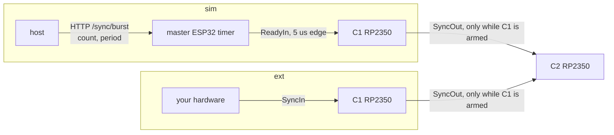
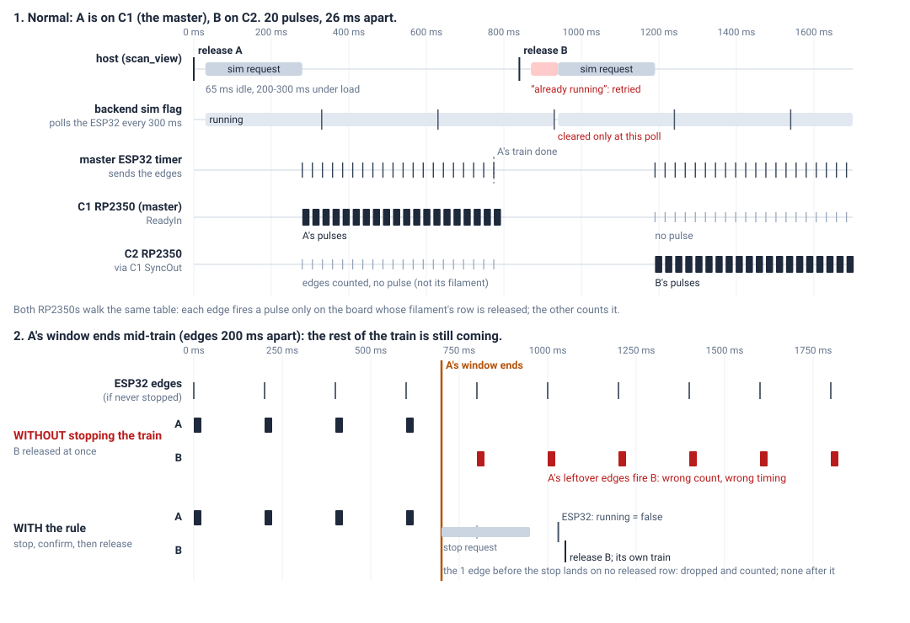
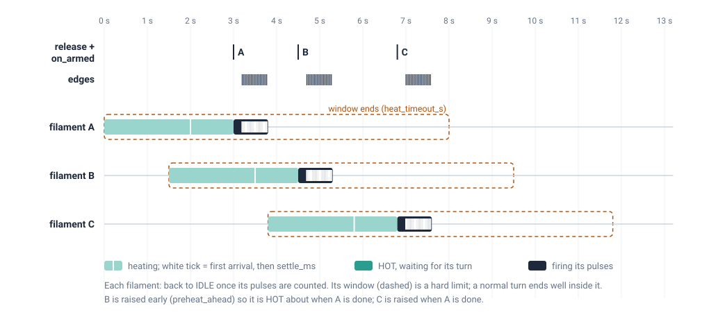
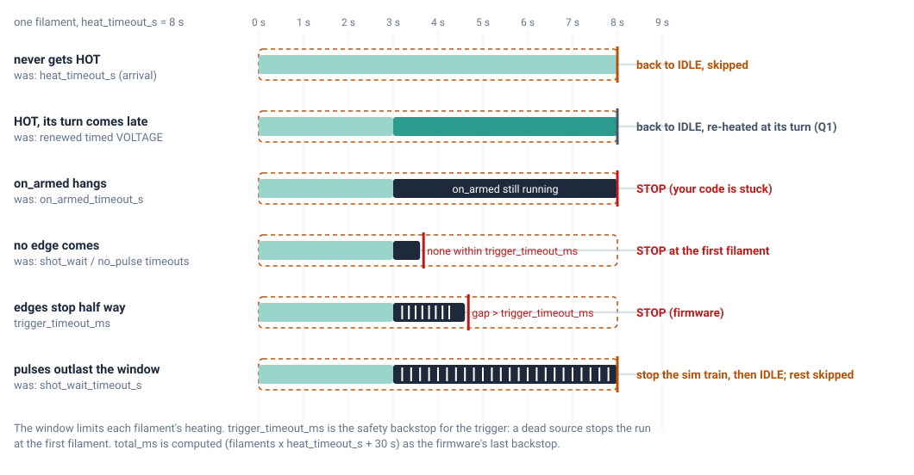

# scan_view and fire_single_pulse — parameters and timing: design

**Status: proposal, nothing built.** Section 12 lists what must be decided
before any code changes.

## 1. What this document designs

- **`scan_view`** fires a list of filaments, strictly in order. Each filament
  gets `num_pulses` HV pulses while it is HOT. The next filaments are already
  heating while one fires, and every filament ends at IDLE.
- **`fire_single_pulse`** does the same for ONE filament. It can also fire a
  filament it does not heat, for tests that manage the heating themselves.

Today the two functions describe the same things with different words.
Arguments overlap and mean slightly different things in each: `heat_timeout_s`,
`settle_ms`, `on_armed()` versus `on_armed(f)`, and 13 timing parameters. This
design gives both of them:

1. **one design language** (§2) and one parameter set;
2. **for every parameter**: what it means, who enforces it, and what it does
   under each choice (sim or ext trigger, voltage or current heating);
3. **the timing**: the workflow step by step, and for every failure, what
   catches it and when.

## 2. The design language

1. **Every argument is named.** No positional arguments: a call without
   names is a TypeError.
2. **One choice = one argument whose value says which.** For example,
   `trigger=ct.Sim(...)` or `trigger=ct.Ext(...)`, and
   `heating=ct.Voltage(...)` or `ct.Current(...)`. "Both" cannot be written.
3. **What only one choice uses lives inside that choice.** The edge spacing
   exists only in `ct.Sim`; the IDLE current, `settle_ms` and `heat_timeout_s`
   exist only inside a heating; the sample rate exists only inside
   `ct.Measure`.
4. **One name, one meaning, in both functions.**

`ct.Sim`, `ct.Ext`, `ct.Voltage`, `ct.Current` and `ct.Measure` take named
arguments only and return a plain dict that carries its kind (for example
`{"kind": "sim", ...}`). A misspelt name fails at once. The dict passes the
remote proxy unchanged, and `on_armed` inside it is still called back. A
hand-written dict is checked the same way: a missing or unknown `kind`, or an
unknown key, is refused.

## 3. The calls

```python
# scan_view, sim trigger
r = ct.scan_view(
    filaments=[0, 1, 95],                       # fired in this order
    heating=ct.Voltage(
        active_mv={0: 7000, 1: 7050, 95: 6950}, # one voltage per filament, exactly
        idle_ma=1200,                           # back to this after its pulses
        settle_ms=1000,                         # HOT = this long after the FIRST arrival
        heat_timeout_s=10,                      # longest one filament may stay heated
    ),
    num_pulses=20,
    width_us=12000,
    trigger=ct.Sim(
        pulse_interval_ms=26,                   # the train's edge spacing
        trigger_timeout_ms=None,                # gap limit; None = 2 x 26 + 100 = 152
        on_armed=None,                          # optional on_armed(f), before each train
    ),
    measure=ct.Measure(rate_hz=1_000_000, bg_gap_us=100.0, bg_window_us=50.0),
    preheat_ahead="auto",                       # rarely changed from here on
    preheat_margin_s=0.3,
    max_hot=6,
    max_voltage_drop_mv=500,
    link_lost_timeout_s=5.0,
    verify=True,
)

# scan_view, ext trigger: only `trigger` differs
r = ct.scan_view(
    filaments=[0, 1, 95],
    heating=ct.Voltage(active_mv={0: 7000, 1: 7050, 95: 6950}, idle_ma=1200,
                       settle_ms=1000, heat_timeout_s=10),
    num_pulses=20,
    width_us=12000,
    trigger=ct.Ext(
        on_armed=on_armed,                      # required: start your edges in on_armed(f)
        trigger_timeout_ms=60,                  # required: gap limit for YOUR spacing
    ),
    measure=ct.Measure(rate_hz=1_000_000, bg_gap_us=100.0, bg_window_us=50.0),
    preheat_ahead="auto",
    preheat_margin_s=0.3,
    max_hot=6,
    max_voltage_drop_mv=500,
    link_lost_timeout_s=5.0,
    verify=True,
)

# fire_single_pulse: one filament, heated by voltage, sim trigger
r = ct.fire_single_pulse(
    filament=16,
    heating=ct.Voltage(active_mv=7000, idle_ma=1200, settle_ms=1000, heat_timeout_s=10),
    num_pulses=20,
    width_us=12000,
    trigger=ct.Sim(pulse_interval_ms=26, trigger_timeout_ms=None, on_armed=None),
    measure=ct.Measure(rate_hz=1_000_000, bg_gap_us=100.0, bg_window_us=50.0),
    controller=None,                            # None = from the filament's board
    reuse=False,                                # True: skip re-download if unchanged
    max_voltage_drop_mv=500,
    link_lost_timeout_s=5.0,
    verify=True,
)

# fire_single_pulse: heated at a CURRENT (ACTIVE), ext trigger
r = ct.fire_single_pulse(
    filament=16,
    heating=ct.Current(active_ma=2900, idle_ma=1200, settle_ms=1000, heat_timeout_s=10),
    num_pulses=1,
    width_us=15000,
    trigger=ct.Ext(on_armed=on_armed, trigger_timeout_ms=3000),
    measure=None,
    controller=None,
    reuse=False,
    max_voltage_drop_mv=500,
    link_lost_timeout_s=5.0,
    verify=True,
)

# fire_single_pulse: NOT heated -- the caller has set the filament's state
r = ct.fire_single_pulse(
    filament=16,
    heating=None,                               # fired in whatever state it is in
    num_pulses=5,
    width_us=1000,
    trigger=ct.Sim(pulse_interval_ms=500, trigger_timeout_ms=None, on_armed=None),
    measure=ct.Measure(rate_hz=1_000_000, bg_gap_us=100.0, bg_window_us=50.0),
    controller=None,
    reuse=False,
    link_lost_timeout_s=5.0,
    verify=True,
)
```

## 4. Who does what

| part | job |
|---|---|
| **host** (the function, running inside the backend) | the order; raises filaments, waits for HOT, releases rows, calls `on_armed`, starts sim trains, decides skip/stop, reads measurements |
| **backend timers** | each filament's heating window (`heat_timeout_s`): drops it to IDLE at the end even if the host has died |
| **master ESP32** (sim only) | its hardware timer sends the sim edges |
| **RP2350, each controller** | regulates the heating; reports arrival and HOT; fires one `width_us` pulse per edge for the released row only; times edge gaps (`trigger_timeout_ms`) |
| **STM32** (master) | measures each pulse inside the master's envelope |
| **your code** | `on_armed(f)`; with `ct.Ext`, the hardware that makes the edges |

## 5. Every parameter

### 5.1 Top level

| parameter | function | meaning | default / range |
|---|---|---|---|
| `filaments` | scan_view | fired strictly in this order | required; no repeats, none dead |
| `filament` | fire_single_pulse | the one filament | required, not dead |
| `heating` | both | §5.2. scan_view: `ct.Voltage` only. fire_single_pulse: `ct.Voltage`, `ct.Current` or `None` | required |
| `num_pulses` | both | pulses per filament = edges per filament (the RP2350 row length) | 1..255 |
| `width_us` | both | the HV pulse width, fired by the RP2350's PIO. The triggering edge does not set it: a sim edge is a fixed 5 µs ESP32 pulse, and an ext edge may be any width | 1..65 535 µs (firmware u16) |
| `trigger` | both | §5.3 | required |
| `measure` | both | §5.4, or `None` | `None` |
| `preheat_ahead`, `preheat_margin_s`, `max_hot` | scan_view | when to raise each filament so it is HOT about when its turn comes; at most `max_hot` heating at once | `"auto"`, 0.3 s, 6 |
| `max_voltage_drop_mv` | both (heated) | a drop larger than this below the target (3 reads) = heating interrupted | 500 mV |
| `controller` | fire_single_pulse | which controller fires; `None` = the filament's own board | `None` |
| `reuse` | fire_single_pulse | skip the download when the schedule is unchanged since your last shot | `False` |
| `verify` | both | read the schedule back before arming | `True` |
| `link_lost_timeout_s` | both | a command link (L2/L3, §10) down this long → STOP. Leave it at 5 s | 5.0 |

### 5.2 `heating=`

| | `ct.Voltage(...)` | `ct.Current(...)` | `None` |
|---|---|---|---|
| for | scan_view, fire_single_pulse | fire_single_pulse | fire_single_pulse |
| heats with | VOLTAGE mode at `active_mv` | ACTIVE at `active_ma` (current loop) | nothing: fired in the state the caller left it in |
| `active_mv` / `active_ma` | scan_view: `{filament: mV}`, **exactly** the filaments listed (Q13); fire_single_pulse: one number | one number, mA | — |
| "arrived" means | load voltage within ±150 mV of `active_mv` | the current loop converged at `active_ma`, not capped | — |
| `idle_ma` | the IDLE current it returns to | same | — |
| `settle_ms` | after the FIRST arrival, wait this long; then it is HOT. A wobble does not restart it; a drop of more than `max_voltage_drop_mv` (3 reads) or an output fault interrupts it. RP2350-timed. 0..60 000 ms | same; interrupted by an output fault | — |
| `heat_timeout_s` | the longest one filament may stay heated in one go, from its heating command until it is back at IDLE. Backend-timed, never renewed | same | — (Q14) |
| schedule | gated: a pulse fires only on a released row whose filament is HOT | gated | NOT gated: any edge after ARM fires; the caller is responsible |

### 5.3 `trigger=`

| | `ct.Sim(...)` — the library makes the edges | `ct.Ext(...)` — your hardware makes the edges |
|---|---|---|
| `on_armed` | optional `on_armed(f)`, called at f's turn; the train starts after it RETURNS | **required** `on_armed(f)`: start your `num_pulses` edges in it (or start what sends them) and return |
| `pulse_interval_ms` | the train's spacing: the master ESP32's timer period is `pulse_interval_ms` × 1000 µs, hardware-timed. Default 500; must be > `width_us`; ≥ 0.5 with `measure` | — (your source sets the spacing; Q12) |
| `trigger_timeout_ms` | the longest gap between two consecutive edges of the same filament, from its first edge. It only catches a lost edge or a dead train. Default 2 × `pulse_interval_ms` + 100; must be > `pulse_interval_ms` | **required**: a little over YOUR spacing. Catches your source stopping mid-filament |
| where edges enter | the master ESP32 → master RP2350 (ReadyIn) | the master's SyncIn |

### 5.4 `measure=ct.Measure(...)` or `None`

| parameter | meaning | default |
|---|---|---|
| `rate_hz` | STM32 sample rate | 1 000 000 |
| `bg_gap_us`, `bg_window_us` | the background is averaged over `bg_window_us`, taken `bg_gap_us` before the pulse's rise and again after it | 100, 50 |

Pulses closer than 0.5 ms (`MIN_INTER_PULSE_US`) leave no clean background.

## 6. The two trigger paths



The rules that hold for both paths:
- C1 is the master: the head of the chain. Every edge reaches C1 first, and C1
  forwards it to C2 only while its own schedule is armed.
- Both RP2350s walk the same table. On each edge, the board whose filament's
  row is released fires a `width_us` pulse; the other board only counts it.
- With a gated schedule, an edge with no released row fires nothing: it is
  dropped and counted (`dropped_edges`).

Specific to `sim`:
- Only the master ESP32 can make a train. If the master's link is down,
  nothing can fire, on either controller.
- There is one HTTP request per filament, after `on_armed` returns. It is
  served by the ESP32's single-threaded web server: about 65 ms when idle,
  200–300 ms under load.
- Only one train can run at a time. The backend learns a train has ended
  only on its next ESP32 poll, every 300 ms. Right after a filament it still
  says "already running", and today the host retries for up to 2 s (Q9).
- **A train runs on its own once started.** If a filament ends before its
  train does, the rest of the train fires the NEXT filament unless the train
  is stopped and confirmed stopped before the next row is released (Q8).



## 7. The workflow

`fire_single_pulse` with a heating is `scan_view` with one filament. It runs
the same steps, with the same gating, the same window and the same failures.
`heating=None` is the one exception, at the end of this section.

**Checks.** Nothing is touched; on failure the call is refused with a reason.

1. The filaments are given, none is repeated, none is dead, and `active_mv`
   has exactly one voltage per listed filament (Q13).
2. HV (emission and focus) is on, the HV guard is not tripped, and the vacuum
   is within its limit.
3. `trigger` and `heating` are of a known kind, and every key is known.
   `width_us` is 1..65 535.
   - `ct.Sim`: `pulse_interval_ms` × 1000 > `width_us`; `trigger_timeout_ms`
     > `pulse_interval_ms`; with `measure`, the spacing is ≥ 0.5 ms.
   - `ct.Ext`: `on_armed` and `trigger_timeout_ms` are given.
4. The window holds one filament's work (§8). If not: Q4.

**Setup.** All filaments are at IDLE.

5. Download ONE gated schedule (all filaments, in order) to every controller
   that fires or frames a pulse, and read it back.
6. Write `settle_ms` and `max_voltage_drop_mv` to the RP2350s, arm the STM32
   measurement, then ARM.

**Per filament f, in order:**

7. **Raise** f: VOLTAGE `active_mv[f]`, or ACTIVE `active_ma`. Do it early
   enough to be HOT by its turn. f's window opens; the backend timer is set
   to `heat_timeout_s`.
8. **HOT**: the RP2350 reports first arrival + `settle_ms`, not interrupted.
9. **Its turn**: the previous filament's pulses are all counted. Release f's
   row on every armed controller.
10. **`on_armed(f)`** is called.
11. **Edges.**
    - `ct.Sim`: one request starts a train of `num_pulses` edges,
      `pulse_interval_ms` apart.
    - `ct.Ext`: your hardware sends `num_pulses` edges.
12. **Pulses**: one `width_us` pulse per edge. From the first edge, every gap
    must be shorter than `trigger_timeout_ms`.
13. **Measurement**: the host reads the STM32 events while they arrive (the
    ESP32 keeps only the last 128).
14. **Done**: all `num_pulses` are counted. f goes back to IDLE as soon as the
    next filament is released, and its window closes.

**End.** This runs whatever ended the run.

15. Stop any sim train and disarm. Every heated filament goes to IDLE (a
    faulted one to SLEEP). Set `settle_ms` back to 0, read the pulse logs, and
    match the measurements to filaments.



**`fire_single_pulse(heating=None)`** skips steps 7, 8 and 14. Nothing is
heated or dropped, and there is no window.
- The schedule is NOT gated: after ARM, any edge fires.
- It is for tests that set the filament's state themselves (the emission
  tests, `measure_pulse_current`).
- `on_armed(f)` is called right after ARM; then the edges come.
- What bounds the run without a window is Q14.

## 8. The heating window: what has to fit in it

From the raise, one filament's work takes:

```
heat-up (raise -> first arrival)        from its history (filament_perf), ~2-3 s at 4-7 V
+ settle_ms / 1000
+ wait for its turn                     ~0 when preheat_ahead="auto" works (scan_view)
+ on_armed                              your code
+ sim only: start request               0.07-0.3 s
+ (num_pulses - 1) x spacing            sim: pulse_interval_ms; ext: your source
```

Worked example, sim, using the first call in §3:
- heat-up 2.5 s + settle 1.0 s + request 0.3 s + 19 × 26 ms (0.49 s) ≈ 4.3 s;
- with `heat_timeout_s` = 10 s, that leaves about 5.7 s of margin;
- `trigger_timeout_ms` defaults to 2 × 26 + 100 = 152 ms.

## 9. When something goes wrong

Each heated filament has one limit, its window. Anything that has not happened
by the end of the window is caught there. `trigger_timeout_ms` catches a gap
between edges. The firmware's last backstop, `total_ms`, is computed:
filaments × `heat_timeout_s` + 30 s.



| failure | caught by | result | old parameter it replaces |
|---|---|---|---|
| never gets HOT | window end | IDLE, skipped, the run goes on | `heat_timeout_s` (wait for arrival) |
| HOT, but its turn comes late | window end | IDLE, re-heated at its turn (Q1) | backend renewed the heating, no limit |
| `on_armed` hangs | window end, `on_armed` still running | STOP | `on_armed_timeout_s` |
| no edge ever comes | window end | IDLE, skipped; 2 filaments in a row: STOP | `shot_wait_timeout_s`, `no_pulse_timeout_s` |
| edges stop half way | `trigger_timeout_ms` | STOP (firmware) — or skip the rest (Q2) | (kept) |
| pulses outlast the window | window end | sim: stop the train and confirm; IDLE; the rest skipped | `shot_wait_timeout_s` |
| dangerous: SHV fault, MOS stuck on, HV guard, vacuum, HV off | checked every 0.5 s | STOP | (unchanged) |
| a command link down > `link_lost_timeout_s` | §10 | STOP | (unchanged) |

STOP means: stop any sim train, disarm, every heated filament to IDLE (a
faulted one to SLEEP), and `stopped` says why. In fire_single_pulse "skipped"
and STOP both end the call, with `ok=False` and the reason.

## 10. Links

| | link | carries | lost: consequence | watched by |
|---|---|---|---|---|
| L1 | your script ↔ backend | the `on_armed` call | `on_armed` cannot be called (Q5) | session ping 3 s, reaper 15 s |
| L2 | backend ↔ ESP32, each controller (WiFi TCP) | release, heating/IDLE, sim start | **no IDLE can be sent: a heated filament stays heated** | `link_lost_timeout_s` (today) |
| L3 | ESP32 ↔ RP2350, each controller (UART) | the same, one hop further | same as L2, while L2 still looks connected | RP2350 heartbeat age — **not watched today** (Q11) |
| L4 | ESP32 ↔ STM32, master (UART) | measurements | measurements lost; firing unaffected | event ids jump → that filament has no measurement |
| L5 | RP2350 ↔ boards (I²C) | heating, arrival, HOT | that filament interrupted → skipped | HOT/interrupted flags |
| L6 | SyncIn/SyncOut wires, envelope | the edges | edges missing | `trigger_timeout_ms`; envelope count |

The RP2350 has no fallback of its own. If L2 or L3 stays down, nothing drops a
heated filament: the backend's window ends, but its IDLE cannot arrive (Q7).

## 11. Removed and renamed

| today | becomes | why |
|---|---|---|
| positional arguments | all named | rule 1 |
| `trigger="sim"/"ext"`, `on_armed`, `pulse_interval_ms`, `trigger_timeout_ms` | `trigger=ct.Sim(...)` / `ct.Ext(...)` | rules 2, 3 |
| scan_view `active_mv`, `idle_ma`, `settle_ms`, `heat_timeout_s` | `heating=ct.Voltage(...)` | rule 3: they exist only when heating |
| fire_single_pulse `active_mv` / `active_ma`, `idle_ma`, `settle_ms`, `heat_timeout_s` | `heating=ct.Voltage(...)` / `ct.Current(...)` / `None` | rules 2, 3 |
| `measure=True`, `rate_hz`, `bg_gap_us`, `bg_window_us` | `measure=ct.Measure(...)` / `None` | rule 3 |
| `heat_timeout_s` = "wait for first arrival" | `heat_timeout_s` = longest heating | the window covers the arrival too |
| `settle_ms` "held continuously" (fire_single_pulse) | "from the first arrival" in both (Q10) | rule 4 |
| `on_armed()` (fire_single_pulse, no argument) | `on_armed(f)` in both | rule 4 |
| `shot_wait_timeout_s`, `timeout_s`, `on_armed_timeout_s`, `no_pulse_timeout_s` | removed | inside the window |
| `total_ms` | removed as a parameter; computed | firmware backstop only |
| `max_on_ms` | removed; the host writes the firmware's maxOnMs | it only restated `width_us` |
| `inter_pulse_ms` (old alias) | removed | `pulse_interval_ms` / `trigger_timeout_ms` |
| fire_single_pulse ungated schedule (heated) | gated, like scan_view | an early ext edge can no longer fire a cold filament |
| backend timed heating length | = `heat_timeout_s`, never renewed | one hard limit |

The low-level `voltage_one` / `active_one` keep `active_s` (heat this long,
then the backend returns it to IDLE): the same idea one level down.

Callers to change in the same step:
- combined_backend: its `fire_single_pulse` and `scan_view` arguments;
- the emission tests and `measure_pulse_current`: they become
  `heating=None`, and their `on_armed` takes `f`.

combined_backend also sets the backend dead-man to `active_timeout_s=4.0`,
which must stay longer than the gap between commands during a window.

## 12. To decide

| | question | proposal |
|---|---|---|
| Q1 | a filament HOT but still waiting when its window ends | back to IDLE, re-heated at its turn (no data lost) |
| Q2 | `trigger_timeout_ms` runs out | today: the firmware stops the whole run. Alternative: skip the rest of that filament (firmware change) |
| Q3 | `heat_timeout_s` default | 10 s |
| Q4 | the window cannot hold one filament's work (§8) | refuse before starting |
| Q5 | ext, your script disconnects mid-run | STOP |
| Q6 | ext `trigger_timeout_ms` | required in `ct.Ext` |
| Q7 | RP2350 drops a heated filament by itself after `heat_timeout_s` if no IDLE comes | yes; firmware change, test board first |
| Q8 | sim: stop and confirm the train before the next row when a filament ends early, and on every STOP | yes |
| Q9 | sim "already running" right after a filament | the backend asks the ESP32 directly; drop the host's 2 s retry |
| Q10 | one `settle_ms` rule for both functions | from the first arrival |
| Q11 | `link_lost_timeout_s` watches L2 only | watch L2 and L3 |
| Q12 | ext: the measurement spacing check (≥ 0.5 ms) needs your spacing | `ct.Ext` gets an optional `expected_interval_ms` used ONLY for that check — or drop the check for ext and flag a pulse whose background was not clean |
| Q13 | `active_mv` keys vs `filaments`: today a missing filament is refused but an EXTRA key is silently ignored (scan_views passes one dict for every view) | refuse extra keys too (a typo like 95 for 59 shows); scan_views passes each view only its own |
| Q14 | `fire_single_pulse(heating=None)` has no window: what bounds it | `trigger_timeout_ms` between edges, and the computed `total_ms` (num_pulses × spacing or `trigger_timeout_ms`, + 30 s) for the wait for the first edge |
