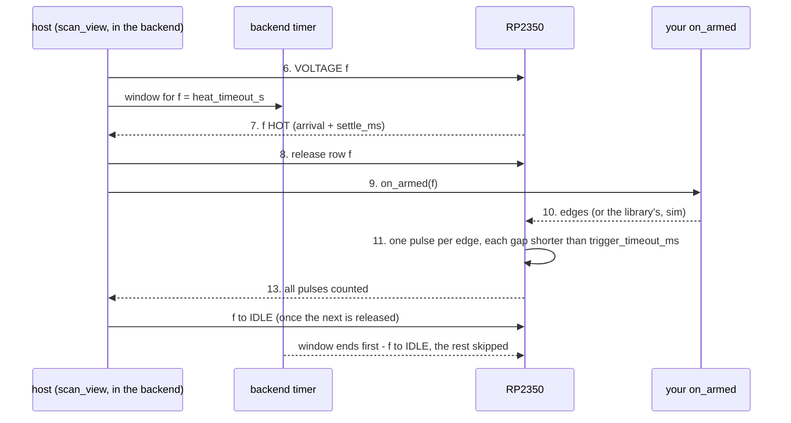

# scan_view timing — paper design (2026-10-28)

Status: **design only, nothing built.** It replaces the timeout section of
`scan_view_design.md` once agreed. Open questions are at the end; every one
needs an answer before code.

Goal: as few timing knobs as possible, each with one meaning, the same name
everywhere it means the same thing.

## 1. What the user sets

| name | meaning | default | when it runs out |
|---|---|---|---|
| `settle_ms` | after a filament FIRST arrives (load voltage within ±150 mV), wait this long; then it is HOT and may fire. Not restarted by a wobble. | required | — (a wait, not a timeout) |
| `heat_timeout_s` | **the longest a filament may stay heated in one go**: from the VOLTAGE command until it is back at IDLE. Hard: timed by the backend, never renewed. | Q4 | that filament back to IDLE; what it had not done is skipped; the run goes on (Q1) |
| `trigger_timeout_ms` | the longest gap between two consecutive edges of the SAME filament, timed by the RP2350 from the filament's first edge | sim: 2 × `pulse_interval_ms` + 100; ext: Q7 | Q2 |
| `link_lost_timeout_s` | how long a link (§4) may be down before the run stops | 5 s; nobody needs to change it | the run stops |

Pulse settings (not timing knobs): `num_pulses`, `width_us`, `pulse_interval_ms`
(sim: the edge spacing the library sends; ext: not used).

## 2. Removed, and what takes their place

| removed | why it is no longer needed |
|---|---|
| `heat_timeout_s` as "wait for the first arrival" | inside the heating window: not HOT by the end of the window = that heating failed |
| `shot_wait_timeout_s` | inside the heating window: pulses not all in by its end = the rest skipped |
| `on_armed_timeout_s` | `on_armed` still running when its filament's window ends: the user's code is stuck; the next filament cannot be called → STOP |
| `no_pulse_timeout_s` | every filament ends within its window, so the run cannot stall. Fixed rule instead: 2 filaments in a row with no edge at all → STOP (the trigger source is dead) |
| `total_ms` (parameter) | computed: number of filaments × `heat_timeout_s` + 30 s, written to the firmware as its last backstop |
| backend timed-VOLTAGE length | = `heat_timeout_s`, no longer "predicted wait + margin, renewed" |
| `max_on_ms` | it only restated `width_us`: the firmware's check IS "width above maxOnMs → ARM refused". `width_us` above what the firmware can hold (u16 µs, 65 535) is refused before anything is touched; the host writes maxOnMs itself. |

## 3. The workflow

Each step happens once, in this order. A filament's heating window opens at
step 6 and closes at step 13 at the latest.

**Before anything is touched (refused with a reason, nothing changed):**

1. Every filament has its own voltage; none is dead; HV (emission and focus)
   is on; HV guard not tripped; vacuum within its limit.
2. `width_us` fits the firmware's u16 µs (1 .. 65 535), else refused.
3. sim: `trigger_timeout_ms` > `pulse_interval_ms`.
4. The window can hold one filament's work: `heat_timeout_s` ≥ typical heat-up
   + `settle_ms` + (`num_pulses` − 1) × spacing + margin. Otherwise refused as
   "heat_timeout_s too short for settle_ms + pulses" (Q5).

**Setup (all at IDLE):**

5. Download ONE gated schedule (every filament of the list, in order) to every
   controller that fires or frames a pulse; read it back; set `settle_ms` on
   the firmware; arm the STM32 measurement; ARM.

**Per filament, strictly in list order:**

6. **Raise** it to VOLTAGE, early enough to be HOT by its turn
   (`preheat_ahead`). Its window starts; the backend's hard timer is set to
   `heat_timeout_s`.
7. **HOT:** the RP2350 reports first arrival + `settle_ms`, not interrupted
   (output fault, lost board, a drop of more than `max_voltage_drop_mv`).
8. **Its turn** (the previous filament's pulses are all counted): release its
   row on every armed controller.
9. **`on_armed(f)`** is called. trigger="ext": your code starts your edges.
10. **Edges:** sim — after `on_armed` returns, ONE request to the MASTER's
    ESP32 starts a hardware-timed train of `num_pulses` edges
    `pulse_interval_ms` apart (§4b); ext — yours. Release → first edge is not
    timed by the firmware.
11. **Pulses:** the firmware fires one `width_us` pulse per edge, only for the
    released row, only while that filament is HOT. Any other edge is dropped
    and counted. From the first edge, each gap must be < `trigger_timeout_ms`.
12. **Measurement:** the host reads the STM32 events while pulses arrive
    (the ESP32 keeps only the last 128).
13. **Done:** all its pulses counted → it goes back to IDLE as soon as the
    next filament is released. Its window closes.

**End (whatever ended it):**

14. Disarm; every filament to IDLE (a faulted one to SLEEP); `settle_ms` back
    to 0; read the pulse logs; match measurements to filaments.



## 3b. Timing: where each removed timeout's job went

A normal run, three filaments (heat_timeout_s = 8 s in the picture). Each
filament has ONE window (dashed): opened by its raise, a hard end. A normal
turn ends well inside it.


Every failure the old timeouts caught, and what catches it now. One filament,
same 8 s window. The vertical bar is the moment it is caught.


| failure | before | now |
|---|---|---|
| never gets HOT | `heat_timeout_s` (wait for arrival) | the window ends: IDLE, skipped |
| HOT, its turn comes late | the backend renewed its timed VOLTAGE (no limit) | the window ends: IDLE, re-heated at its turn (Q1) |
| `on_armed` hangs | `on_armed_timeout_s` | the window ends with `on_armed` still running: STOP |
| no edge ever comes | `shot_wait_timeout_s`; a dead source: `no_pulse_timeout_s` | the window ends: IDLE, skipped; 2 filaments in a row with no edge: STOP |
| edges stop half way | `trigger_timeout_ms` | the same (kept); Q2 |
| pulses outlast the window | `shot_wait_timeout_s` | the window ends: stop the sim train (confirmed), IDLE, rest skipped |
| the whole run hangs | `total_ms` (parameter) | the same firmware backstop, computed: filaments × `heat_timeout_s` + 30 s |

## 4. "Link": which one

A run depends on six links. Only some are worth a timeout.

| | link | carries during a run | lost: what happens | detected by |
|---|---|---|---|---|
| L1 | your script ↔ backend (HTTP, remote session) | the `on_armed` call-back | the run lives in the backend; it cannot call `on_armed` | session pings (3 s), reaper 15 s |
| L2 | backend ↔ ESP32, per controller (TCP over WiFi) | release, VOLTAGE / IDLE commands, status | **no IDLE can be sent: a heated filament stays heated** | `connected` (socket open) — what `link_lost_timeout_s` watches today |
| L3 | ESP32 ↔ RP2350, per controller (UART 460 800) | the same commands, one hop further | same as L2, but L2 still looks "connected" | RP2350 heartbeat age (`rp_age_ms`) — **not watched today** |
| L4 | ESP32 ↔ STM32 on the master (UART 921 600) | per-pulse measurements | measurements lost; firing unaffected | STM32 LINK_LOST, event ids jump |
| L5 | RP2350 ↔ boards (I²C, per channel) | arrival, HOT, heating | that filament's heating interrupted | the HOT/interrupted flags; port lost |
| L6 | SyncOut → SyncIn chain, envelope to the STM32 (wires) | the edges themselves | edges missing | `trigger_timeout_ms`; envelope count ≠ pulses |

Proposal:
- `link_lost_timeout_s` watches **L2 and L3**: these carry the commands that
  bring a filament back to IDLE. Today only L2 is watched.
- L4 loses measurements only: recorded, not a stop. L5 is per filament (the
  filament is skipped, §3 step 7). L6 is `trigger_timeout_ms`. L1: Q6.
- **Firmware gap:** the RP2350 has no fallback of its own. If L2 or L3 stays
  down, nothing drops a heated filament: the backend's timer fires but its
  IDLE cannot arrive (Q8).

## 4b. trigger="sim": a path of its own

How a simulated edge is made (ESP32 `sync_io.cpp`, `config_portal.cpp`):

```
backend --HTTP /sync/burst--> MASTER ESP32 hardware timer
        --ReadyIn wire--> master RP2350 (fires its released row)
        --SyncOut--> the other RP2350's SyncIn (fires its released row)
```

What follows from it:

- **Only the master can start a train.** The other controller's filaments get
  their edges through SyncOut → SyncIn (L6). With the master's L2 down,
  nothing can fire, even on the other controller.
- **Starting costs a request inside the window.** One HTTP request per
  filament, after `on_armed` returns, served by the ESP32's single-threaded
  web server (≈ 65 ms idle, 200–300 ms under load). It is part of the step-4
  budget.
- **One train at a time.** The ESP32 refuses a second while one runs. The
  backend learns a train has ended only on its next ESP32 poll (every 0.3 s),
  so right after a filament it still says "already running"; today the host
  retries that for up to 2 s, which comes out of the next filament's window.
  Proposal: when its flag says running, the backend asks the ESP32 at once
  instead of the host retrying (Q11).
- **The train runs on its own.** Once started, the ESP32 sends every edge
  whatever the host decides. If a filament ends early (its window runs out,
  or the run stops) and the next row is released while the old train is still
  going, **its remaining edges fire the NEXT filament**. Today scan_view never
  stops a train (it only disarms), and the backend's `simulate-stop` only sets
  a flag its 0.3 s poll acts on. Rule: a filament that ends before its train
  does → stop the train and CONFIRM it stopped (ESP32 status `running=false`)
  before the next row is released; every STOP also stops the train (Q10).
- **Spacing limits.** `pulse_interval_ms` > `width_us` (an edge while the
  pulse is still on is discarded); the ESP32 minimum period is the SyncOut
  width + 20 µs; measuring needs ≥ 0.5 ms (the backgrounds); a spacing that
  does not divide 1 s needs ESP32 firmware with `period_us`.
- **`trigger_timeout_ms` in sim** only catches a lost edge or a dead train
  (the spacing is hardware-timed): the default 2 × `pulse_interval_ms` + 100
  is enough.
- **`on_armed` in sim** is optional; the train starts only after it returns,
  so its time is inside the window.

## 5. Names across the API

| meaning | scan_view | fire_single_pulse | low level (`voltage_one` / `active_one`) |
|---|---|---|---|
| longest one heating may last | `heat_timeout_s` (new meaning) | `heat_timeout_s` (changes from "wait for arrival") | `active_s` (unchanged) |
| wait after the first arrival | `settle_ms` (from the FIRST arrival) | `settle_ms` (held continuously) — Q9 | — |
| gap between edges | `trigger_timeout_ms` | `trigger_timeout_ms` | — |

combined_backend passes today, all of which have to follow:
- to `fire_single_pulse`: `max_on_ms` (goes), `total_ms`, `shot_wait_timeout_s`,
  `heat_timeout_s`, `settle_ms`;
- to `scan_view`: `trigger_timeout_ms`, `max_on_ms` (goes), `total_ms`,
  `shot_wait_timeout_s`, `heat_timeout_s`, `link_lost_timeout_s`,
  `preheat_margin_s`.

It also sets the backend's dead-man to `active_timeout_s=4.0` (a heated
filament nobody renews for 4 s falls back), which a long window must not trip.

## 6. Open questions

- **Q1** The window runs out while a filament is HOT but still waiting for its
  turn (the one before it took long). Back to IDLE and **re-heat it at its
  turn** (no data lost; a new window) — or skip it?
- **Q2** `trigger_timeout_ms` runs out: today the firmware faults the WHOLE run
  (InterPulseTimeout → STOP). Keep that — or skip only the rest of that
  filament (needs a firmware change: the timeout ends the row, not the run)?
- **Q4** `heat_timeout_s` default (10 s fits today's 4 V test: ~3 s heat-up +
  1 s settle + 20 pulses × 26 ms, with margin)?
- **Q5** Step 4: refuse a window that cannot hold one filament's work, or only
  warn?
- **Q6** L1 lost (your script gone) with trigger="ext": stop the run at once,
  or let the current filament finish?
- **Q7** ext default for `trigger_timeout_ms` (today 3000 ms) — or required
  with ext, since only you know your edge spacing?
- **Q8** RP2350 firmware: a timed VOLTAGE of its own (the board drops to IDLE
  by itself after `heat_timeout_s`), so a heated filament is safe even with L2
  or L3 down. Firmware change, test board first.
- **Q10** sim: stop and confirm the train before releasing the next row when
  a filament ends early, and on every STOP (§4b)? Without it a leftover train
  fires the next filament.
- **Q11** sim "already running" right after a filament: fix it in the backend
  (ask the ESP32 directly) and drop the host's 2 s retry?
- **Q9** `settle_ms` in fire_single_pulse is "held continuously"; in scan_view
  "from the first arrival". Make them the same (which one)?
